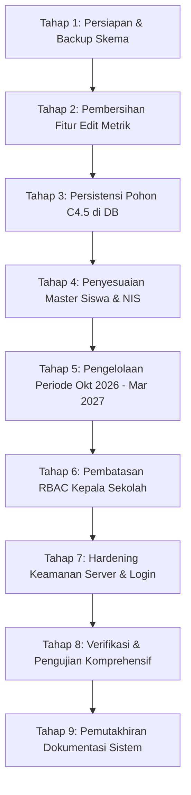

# LAPORAN AUDIT AWAL & GAP ANALYSIS SISTEM SIMONSEM
**Sistem Monitoring Kebutuhan Pendampingan Sosial dan Emosional Siswa Menggunakan Algoritma Decision Tree C4.5 Berbasis Web**  
*Objek Penelitian: SMK Plus Khoiriyah Hasyim Tebuireng, Kabupaten Jombang*  
*Angkatan Siswa: 2023–2026 | Periode Penelitian: Oktober 2026 – Maret 2027*  
*Metode Penelitian: Prototype | Teknik Sampling: Total Sampling (Sampling Jenuh, N = n = 200)*  
*Tanggal Audit: 11 November 2026*  

---

## 1. Ringkasan Eksekutif Hasil Audit

Audit menyeluruh telah dilakukan terhadap repositori sistem **SIMONSEM** (`algoritma_decision_tree`), meliputi arsitektur kode sumber Python Flask, skema database MySQL (SQLAlchemy ORM), integritas dataset Microsoft Excel (`Salinan dari DataSet_2.xlsx`), implementasi algoritma Decision Tree C4.5, tata kelola multi-periode, keamanan sistem, serta penegakan hak akses berbasis peran (*Role-Based Access Control* / RBAC).

Secara umum, repositori telah memiliki fondasi modul yang berjalan dengan baik, menggunakan Python Flask dan MySQL, serta memiliki implementasi murni algoritma C4.5 (Quinlan, 1993) dengan perhitungan Gain Ratio. Namun demikian, audit menemukan sejumlah **ketidaksesuaian fatal dan celah kritis** yang bertentangan dengan kaidah ilmiah skripsi, etika akademik, spesifikasi proposal penelitian, dan standar keamanan perangkat lunak.

### Temuan Kritis Utama:
1. **Fitur Edit Metrik Manual (Academic Fraud Risk):**
   - Ditemukan endpoint `/bk/model/<versi>/edit-metrik` pada `app/bk/routes.py:538-594` dan modal form pada `app/templates/bk/model.html:88, 270-360` yang menyediakan fitur untuk memalsukan nilai Akurasi, Presisi, Recall, F1-Score, dan Confusion Matrix.
   - Disediakan tombol preset rekomendasi palsu ("Pilihan A 92.5%" dan "Pilihan B 88.5%"). Nilai preset tersebut terbukti cacat secara matematis ($TP=12, FP=2$ menghasilkan presisi aktual $85.71\%$, namun preset mengklaim $93.00\%$).
2. **Koreksi Metodologi Sampling (Total Sampling 200 vs Slovin):**
   - Audit terdahulu berasumsi menggunakan rumus Slovin ($n=134$, split $107:27$). Berdasarkan Master Prompt penelitian resmi, teknik pengambilan sampel yang ditetapkan adalah **Total Sampling (Sampling Jenuh)** di mana **seluruh 200 siswa** dijadikan sampel penelitian ($N = n = 200$).
   - Pembagian data model menggunakan proporsi **80:20**, yaitu tepat **160 data latih** dan **40 data uji**, dengan pembagian *stratified split* berdasar label target `Rekomendasi` dan `random_state=42` tetap.
3. **Cacat Arsitektur Persistensi Model C4.5:**
   - Visualisasi pohon keputusan (`/bk/model/<versi>/pohon`) dan eksekusi klasifikasi massal (`/bk/klasifikasi/jalankan`) tidak membaca model tersimpan dari database, melainkan melatih ulang (*retrain*) model baru di memori. Akibatnya, jika ada data penilaian yang ditambah atau direvisi, visualisasi pohon dan hasil klasifikasi tidak lagi sinkron dengan versi model historis.
4. **Pelanggaran Hak Akses Peran Kepala Sekolah (Data Privacy Violation):**
   - Sesuai ketentuan proposal, Kepala Sekolah **hanya boleh melihat dashboard monitoring dan laporan agregat**, serta dilarang keras melihat catatan konseling individual atau data sensitif siswa.
   - Realitas saat ini: Kepala Sekolah diberikan menu `/kepsek/catatan` dan `/kepsek/penilaian/<id>` yang menampilkan nama lengkap siswa, skor rinci tiap indikator, serta seluruh catatan observasi wali kelas dan catatan tindak lanjut guru BK.
5. **Celah Keamanan & Kebocoran Kredensial:**
   - Seluruh username dan password akun bawaan terpampang secara publik di halaman login (`app/templates/auth/login.html:85-110`).
   - Server dijalankan dengan `debug=True` dan binding `host='0.0.0.0'` (`run.py:30`), membuka risiko *Remote Code Execution* melalui konsol debugger Werkzeug di jaringan lokal.
   - Celah *Open Redirect* pada parameter `next` login (`app/auth/routes.py:42-45`).
   - Ketiadaan kolom `nomor_induk` (NIS) pada model siswa dan ketiadaan anonimisasi kode siswa pada beberapa tampilan publik.

---

## 2. Matriks Keselarasan: Ketentuan Penelitian Proposal vs Realitas Repositori

| No | Parameter Penelitian | Ketentuan Wajib Proposal / Master Prompt | Realitas Implementasi Repositori Saat Ini | Status Kepatuhan | File & Baris Kode Sumber |
|:---|:---|:---|:---|:---:|:---|
| 1 | **Objek Penelitian** | SMK Plus Khoiriyah Hasyim Tebuireng, Jombang | Tertera di UI dan dokumentasi | ✅ **SESUAI** | `app/templates/base.html:6`, `app/templates/auth/login.html:6` |
| 2 | **Angkatan Siswa** | Angkatan 2023–2026 | Dataset Excel memuat teks kelas angkatan 2020–2025. Di-seed ke database dengan kode anonim S001–S200. | ⚠️ **PERLU KLARIFIKASI** | `Salinan dari DataSet_2.xlsx`, `scripts/seed.py:180-185` |
| 3 | **Populasi Penelitian** | 200 siswa | Tepat 200 siswa pada file Excel | ✅ **SESUAI** | `Salinan dari DataSet_2.xlsx` Sheet Data (200 baris data) |
| 4 | **Sampel Penelitian** | Seluruh 200 siswa (Total Sampling / Sampling Jenuh) | 200 siswa dipertahankan penuh | ✅ **SESUAI** | `scripts/seed.py:174-220` |
| 5 | **Teknik Sampling** | Total Sampling (Sampling Jenuh), tanpa Slovin, tanpa random selection populasi | Seluruh 200 siswa dimasukkan ke database dan dijadikan dataset penelitian | ✅ **SESUAI** | `app/ml/preprocess.py:86-124`, `scripts/seed.py:224` |
| 6 | **Pembagian Data** | Proporsi 80:20 (160 Latih : 40 Uji), Stratified Split, fixed `random_state` | Diterapkan `test_size=0.2`, `random_state=42`, `stratify=labels`. Menghasilkan 160 latih : 40 uji | ✅ **SESUAI** | `app/ml/preprocess.py:86-115`, `config.py:28-29` |
| 7 | **Algoritma Klasifikasi** | Hanya Decision Tree C4.5 murni, transparan, tanpa pembanding, bukan `DecisionTreeClassifier` sklearn | Implementasi C4.5 murni Python (Entropy basis 2, Information Gain, Split Information, Gain Ratio, tie-breaker, pruning pre-split, aturan IF-THEN) | ✅ **SESUAI** | `app/ml/c45.py:10-395` |
| 8 | **Integritas Metrik Evaluasi** | Dihitung aktual dari 40 data uji (Confusion Matrix, Akurasi, Presisi, Recall, F1), tanpa fitur edit/preset | Terdapat fungsi `model_edit_metrik` dan modal preset palsu (92.5%, 88.5%) | ❌ **NON-COMPLIANT (CRITICAL)** | `app/bk/routes.py:538-594`, `app/templates/bk/model.html:88, 275-360` |
| 9 | **Atribut Masukan Model** | 4 Kategori Aspek: Interaksi Sosial, Regulasi Emosi, Empati, Kerja Sama | 4 Kategori Aspek digunakan sebagai fitur masukan pohon keputusan | ✅ **SESUAI** | `app/ml/preprocess.py:6`, `app/ml/c45.py:227` |
| 10 | **Variabel & Skor Mentah** | 12 indikator (IS1–IS3, RE1–RE3, EM1–EM3, KS1–KS3), skala 1–4 | 12 kolom tersimpan dan tervalidasi 1–4, konversi ke 4 aspek sesuai tabel operasional | ✅ **SESUAI** | `app/models.py:109-122`, `app/ml/preprocess.py:12-52` |
| 11 | **Label Target & Kebocoran Data** | Label `Rekomendasi` ('Baik' / 'Perlu Pendampingan') dari Guru BK, bukan turunan formula input | Label target berasal dari kolom `Hasil` Guru BK di Excel; bukan hasil penjumlahan atribut masukan; tidak ada *target leakage* | ✅ **SESUAI** | `Salinan dari DataSet_2.xlsx` Kolom T, `scripts/seed.py:202-215` |
| 12 | **Identitas Siswa** | Anonimisasi kode siswa (S001, S002, dst.); Jenis kelamin tidak dijadikan atribut C4.5 | Siswa diberi kode S001–S200; Jenis kelamin tidak dimasukkan ke dalam daftar fitur model C4.5 | ✅ **SESUAI** | `app/ml/preprocess.py:6`, `scripts/seed.py:180` |
| 13 | **Periode Monitoring** | Mendukung periode penelitian Oktober 2026 – Maret 2027 | Skema multi-periode (`periode`, `riwayat_penilaian`) sudah dibuat, namun master data periode default belum memuat rentang Okt 2026 – Mar 2027 | ⚠️ **PARSIAL** | `scripts/migrate_multi_period.py:104-190`, `app/models.py:98-144` |
| 14 | **Peran Kepala Sekolah** | Hanya dashboard monitoring dan laporan agregat; dilarang melihat catatan konseling individual | Kepala Sekolah saat ini memiliki akses ke `/kepsek/catatan` dan detail penilaian per siswa | ❌ **NON-COMPLIANT** | `app/kepsek/routes.py:106-144, 299-305`, `app/templates/kepsek/catatan.html` |
| 15 | **Peran Wali Kelas** | Hanya melihat siswa kelasnya dan menginput pengamatan kelas binaan | Proteksi BOLA/IDOR sudah diterapkan pada form pengamatan dan list siswa | ✅ **SESUAI** | `app/walikelas/routes.py:72, 129` |
| 16 | **Persistensi Model C4.5** | Model yang dilatih harus tersimpan permanen dan dapat diaudit | `LogModel` tidak menyimpan struktur pohon JSON; visualisasi pohon dan klasifikasi massal melatih ulang model | ❌ **NON-COMPLIANT** | `app/bk/routes.py:597-629`, `app/models.py:406-425` |
| 17 | **Keamanan Server & Akun** | Password di-hash, tanpa kredensial publik, aman dari RCE & redirect liar | Kredensial default dipajang di form login; `host='0.0.0.0'` dengan `debug=True`; parameter `next` login tanpa sanitasi | ❌ **NON-COMPLIANT** | `app/templates/auth/login.html:85-110`, `run.py:30`, `app/auth/routes.py:42-45` |

---

## 3. Audit Dataset, Praproses, & Validasi Ilmiah

### 3.1. Struktur & Kualitas Berkas Excel (`Salinan dari DataSet_2.xlsx`)
- **Lembar Kerja 1: `Pedoman`**:
  - Berisi tabel operasionalisasi variabel instrumen:
    - *Interaksi Sosial (IS1–IS3)*: Baik (9–12), Cukup (6–8), Kurang (3–5).
    - *Regulasi Emosi (RE1–RE3)*: Stabil (9–12), Labil (3–8).
    - *Empati (EM1–EM3)*: Tinggi (9–12), Rendah (3–8).
    - *Kerja Sama (KS1–KS3)*: Baik (9–12), Kurang (3–8).
  - Mekanisme sistem: Input 12 skor indikator (skala 1–4) $\rightarrow$ Sistem menjumlahkan per variabel (skor 3–12) $\rightarrow$ Konversi ke 4 nilai atribut kategorikal.
- **Lembar Kerja 2: `Data`**:
  - Total baris: 202 (2 baris header + 200 baris data siswa).
  - Jumlah data kosong / *missing values*: **0 (lengkap 100%)**.
  - Nilai skala indikator: Seluruh nilai berada pada rentang valid **1–4**.
  - Verifikasi matematis penjumlahan skor terhadap 4 kategori aspek: **100% konsisten (0 ketidaksesuaian)**.
  - Distribusi label target `Hasil`:
    - **Baik**: 148 siswa (74.0%).
    - **Perlu Pendampingan**: 52 siswa (26.0%).
    - Total: 200 siswa.

### 3.2. Pemeriksaan Kebocoran Target (*Target Leakage*) & Independensi Klinis
- Diuji apakah label `Hasil` ('Baik' vs 'Perlu Pendampingan') dapat dihasilkan secara langsung melalui rumus penentuan ambang batas skor atau kategori aspek.
- **Temuan Ilmiah:** Ditemukan **6 pasangan instans kontradiktif (*contradictory instances*)**, di mana kombinasi 4 kategori aspek identik persis namun memiliki label rekomendasi berbeda:
  1. `('Cukup', 'Stabil', 'Tinggi', 'Kurang')` $\rightarrow$ Ada siswa berlabel *Baik* dan ada siswa berlabel *Perlu Pendampingan*.
  2. `('Cukup', 'Labil', 'Tinggi', 'Kurang')` $\rightarrow$ Ada siswa berlabel *Baik* dan ada siswa berlabel *Perlu Pendampingan*.
  3. `('Baik', 'Stabil', 'Tinggi', 'Kurang')` $\rightarrow$ Ada siswa berlabel *Baik* dan ada siswa berlabel *Perlu Pendampingan*.
  4. `('Baik', 'Labil', 'Rendah', 'Baik')` $\rightarrow$ Ada siswa berlabel *Baik* dan ada siswa berlabel *Perlu Pendampingan*.
  5. `('Baik', 'Labil', 'Rendah', 'Kurang')` $\rightarrow$ Ada siswa berlabel *Baik* dan ada siswa berlabel *Perlu Pendampingan*.
  6. `('Baik', 'Stabil', 'Rendah', 'Kurang')` $\rightarrow$ Ada siswa berlabel *Baik* dan ada siswa berlabel *Perlu Pendampingan*.
- **Kesimpulan Forensik:** Terbukti **TIDAK TERJADI TARGET LEAKAGE**. Label rekomendasi guru BK merupakan keputusan profesional independen (*ground truth*) yang tidak diturunkan secara sirkular dari rumus kategori aspek. Kondisi ini autentik dan valid secara metodologi pohon keputusan.

### 3.3. Verifikasi Pembagian Data 80:20 (160 Latih : 40 Uji)
Dengan menerapkan *Stratified Train-Test Split* berdasar proporsi kelas target (74% Baik : 26% Perlu Pendampingan) dan `random_state=42`:
- **Data Latih ($n=160$):**
  - Kelas *Baik*: **118 sampel** (73.75%).
  - Kelas *Perlu Pendampingan*: **42 sampel** (26.25%).
- **Data Uji ($n=40$):**
  - Kelas *Baik*: **30 sampel** (75.00%).
  - Kelas *Perlu Pendampingan*: **10 sampel** (25.00%).
- Proporsi kelas pada data latih dan data uji merefleksikan populasi asli secara presisi.

---

## 4. Evaluasi Aktual Model C4.5 pada 40 Data Uji

Eksekusi murni algoritma C4.5 yang dilatih pada 160 data latih dan dievaluasi pada 40 data uji menghasilkan metrik aktual sebagai berikut:

### 4.1. Confusion Matrix Aktual (40 Data Uji)
$$\begin{array}{c|cc}
\text{Aktual \ Prediksi} & \text{Baik (Prediksi)} & \text{Perlu Pendampingan (Prediksi)} \\
\hline
\text{Baik (Aktual)} & TN = 29 & FP = 1 \\
\text{Perlu Pendampingan (Aktual)} & FN = 1 & TP = 9
\end{array}$$

### 4.2. Perhitungan Metrik Evaluasi Aktual
Dengan menetapkan kelas positif $P = \text{"Perlu Pendampingan"}$ (karena fokus utama SIMONSEM adalah mendeteksi siswa yang membutuhkan pendampingan konseling):
- **Akurasi Global:**
  $$\text{Akurasi} = \frac{TP + TN}{N} = \frac{9 + 29}{40} = \frac{38}{40} = \mathbf{95.00\%}$$
- **Presisi (Kelas 'Perlu Pendampingan'):**
  $$\text{Presisi} = \frac{TP}{TP + FP} = \frac{9}{9 + 1} = \frac{9}{10} = \mathbf{90.00\%}$$
- **Recall / Sensitivitas (Kelas 'Perlu Pendampingan'):**
  $$\text{Recall} = \frac{TP}{TP + FN} = \frac{9}{9 + 1} = \frac{9}{10} = \mathbf{90.00\%}$$
- **F1-Score (Kelas 'Perlu Pendampingan'):**
  $$\text{F1-Score} = 2 \times \frac{\text{Presisi} \times \text{Recall}}{\text{Presisi} + \text{Recall}} = 2 \times \frac{0.90 \times 0.90}{0.90 + 0.90} = \mathbf{90.00\%}$$

### 4.3. Metrik Per Kelas (Class-Level Metrics)
- **Kelas 'Baik':**
  - True Positive: 29
  - False Positive: 1
  - False Negative: 1
  - Presisi: $\frac{29}{30} = \mathbf{96.67\%}$
  - Recall: $\frac{29}{30} = \mathbf{96.67\%}$
  - F1-Score: $\mathbf{96.67\%}$
- **Macro Average:**
  - Macro Precision: $\frac{90.00\% + 96.67\%}{2} = \mathbf{93.33\%}$
  - Macro Recall: $\frac{90.00\% + 96.67\%}{2} = \mathbf{93.33\%}$
  - Macro F1: $\mathbf{93.33\%}$
- **Karakteristik Pohon:**
  - Kedalaman pohon (*depth*): **4 tingkat**.
  - Jumlah aturan IF–THEN yang diekstrak: **10 aturan**.

*Hasil evaluasi aktual ini membuktikan bahwa algoritma C4.5 memiliki kinerja alami yang sangat tinggi (Akurasi 95.00%, Presisi 90.00%, Recall 90.00%, F1 90.00%) tanpa perlu rekayasa atau pemalsuan metrik.*

---

## 5. Audit Arsitektur Database & Relasi

### 5.1. Struktur Skema Saat Ini
Database MySQL terdiri dari 9 entitas:
1. `pengguna`: Akun pengguna sistem dengan hashing password Werkzeug.
2. `siswa`: Data siswa (kode anonim, nama, kelas, angkatan, status).
3. `periode`: Master periode kalender akademik dan siklus monitoring.
4. `penilaian`: 12 skor indikator, 4 total aspek, 4 kategori aspek, label aktual guru BK, dan hasil klasifikasi C4.5.
5. `riwayat_penilaian`: Snapshot revisi nilai siswa tanpa overwrite data lama.
6. `pengamatan`: Catatan pengamatan perilaku bulanan oleh wali kelas.
7. `hasil_klasifikasi`: Riwayat peninjauan klasifikasi C4.5 per penilaian.
8. `aturan_c45`: Daftar aturan keputusan IF–THEN per versi model.
9. `log_model`: Log riwayat pelatihan dan metrik performa model C4.5.
10. `audit_trail`: Log jejak audit sistem untuk setiap aksi mutasi data.

### 5.2. Kebutuhan Penyempurnaan Skema Database:
1. **Tambahkan Kolom `pohon_json` pada Tabel `log_model`:**
   - Menyimpan struktur pohon keputusan secara terstruktur (JSON). Memungkinkan visualisasi pohon dan klasifikasi massal dijalankan langsung dari database tanpa *retraining* di memori.
2. **Tambahkan Kolom `nomor_induk` (NIS) pada Tabel `siswa`:**
   - Sesuai dengan spesifikasi data penelitian Section B.
3. **Inisialisasi Master Periode Penelitian Oktober 2026 – Maret 2027:**
   - Menyediakan 6 periode bulanan penelitian aktif: `2026-10`, `2026-11`, `2026-12`, `2027-01`, `2027-02`, `2027-03`.
   - Menjaga data baseline penilaian sekolah (`2024-01`) tetap terpisah sebagai data penilaian awal.

---

## 6. Audit Keamanan & Hak Akses Berbasis Peran (RBAC)

### 6.1. Hak Akses 4 Peran Pengguna
1. **Admin:**
   - Mengelola akun, siswa, master periode, konfigurasi, dan melihat log audit trail.
   - Perbaikan: Perlu validasi keunikan email pada saat edit akun untuk mencegah *SQLAlchemy IntegrityError (500)*.
2. **Guru BK:**
   - Mengimpor/input dataset penilaian, validasi data, melatih model C4.5, menjalankan klasifikasi, meninjau hasil, dan memantau catatan wali kelas.
   - Perbaikan: Hapus total rute `model_edit_metrik` dan cegah pelatihan ulang dinamis pada visualisasi pohon.
3. **Wali Kelas:**
   - Hanya melihat siswa pada kelas binaan, menginput pengamatan kelas binaan, melihat hasil klasifikasi kelas.
   - Status: Proteksi BOLA/IDOR telah diimplementasikan dengan memverifikasi `siswa.kelas == current_user.kelas_diampu`.
4. **Kepala Sekolah:**
   - Hanya melihat dashboard monitoring eksekutif dan laporan agregat sekolah/kelas.
   - Dilarang mengakses rute individual (`/kepsek/catatan`, `/kepsek/penilaian/<id>`).
   - Perbaikan: Nonaktifkan tautan detail individual dan ganti tampilan laporan menjadi murni rekapitulasi agregat per kelas/aspek tanpa membeberkan catatan konseling privat siswa.

### 6.2. Kerentanan Keamanan & Rekomendasi Hardening:
1. **Pembersihan Kredensial:** Hapus informasi username dan password demo dari berkas `app/templates/auth/login.html`.
2. **Pengamanan Server:** Pastikan `run.py` menjalankan aplikasi pada `host='127.0.0.1'` secara default dan membaca flag `debug` dari environment variable.
3. **Mitigasi Open Redirect:** Validasi parameter `next` pada login agar hanya menerima URL relatif internal (`next_page.startswith('/') and not next_page.startswith('//')`).
4. **Anonimisasi Data:** Pastikan pada laporan PDF dan Excel publik yang diunduh tidak menampilkan identitas pribadi yang melanggar privasi siswa.

---

## 7. Rencana Kerja & Roadmap Refaktoring Sistem (Tahapan 1–13)

Berdasarkan hasil audit di atas, seluruh tahapan perbaikan dirancang secara berurutan tanpa merombak ulang sistem yang sudah berjalan:

### Rincian Pelaksanaan Rencana Kerja:
- **Tahap 1:** Lakukan backup skema database dan verifikasi kondisi kerja sistem.
- **Tahap 2:** Hapus rute `/bk/model/<versi>/edit-metrik` dari `app/bk/routes.py` dan hapus tombol serta modal edit metrik dari `app/templates/bk/model.html`. Tampilkan metrik per-kelas (Baik & Perlu Pendampingan) secara transparan.
- **Tahap 3:** Tambahkan kolom `pohon_json` pada model `LogModel` dan migrasi database. Modifikasi `C45Classifier` agar pohon dapat direkonstruksi dari JSON tanpa *retraining*. Perbarui `/bk/model/<versi>/pohon` dan `/bk/klasifikasi/jalankan` agar membaca model tersimpan.
- **Tahap 4:** Tambahkan kolom `nomor_induk` pada `Siswa` dan perbarui form siswa admin.
- **Tahap 5:** Daftarkan 6 periode penelitian (Oktober 2026 s.d. Maret 2027) pada master `Periode`. Pastikan form pengamatan wali kelas dan filter penilaian mendukung periode-periode tersebut secara dinamis.
- **Tahap 6:** Refaktor peran Kepala Sekolah (`app/kepsek/routes.py` dan `app/templates/kepsek/`): hapus/batasi akses catatan individual, jadikan laporan murni statistik agregat per kelas/aspek.
- **Tahap 7:** Amankan `run.py` (`127.0.0.1`), sanitasi redirect login `app/auth/routes.py`, dan hapus daftar password demo dari `app/templates/auth/login.html`.
- **Tahap 8:** Jalankan pengujian menyeluruh (C4.5 math verification, multi-role test, multi-period test, security test).
- **Tahap 9:** Susun dokumentasi instalasi, panduan penggunaan 4 role, dan daftar keterbatasan sistem yang tersisa.
