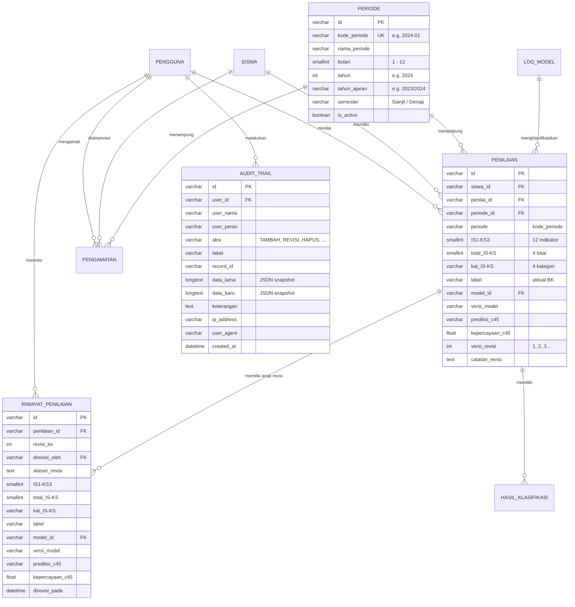

# LAPORAN REFAKTOR DATABASE MULTI-PERIODE SIMONSEM
**Sistem Informasi Monitoring Sosial Emosional Siswa (SIMONSEM)**  
*SMK Plus Khoiriyah Hasyim Tebuireng Jombang*  
Tanggal Eksekusi: 11 November 2026

---

## 1. Ringkasan Eksekutif

Refaktor database ini dilakukan untuk memenuhi spesifikasi metodologis proposal penelitian SIMONSEM:
1. **Dukungan Monitoring Multi-Periode Sejati:** Satu siswa dapat memiliki banyak penilaian pada periode yang berbeda, dan satu pengamatan wali kelas tertaut secara eksplisit pada periode pemantauan yang bersangkutan.
2. **Riwayat Penilaian Tanpa Overwrite (*Non-Destructive Revision*):** Setiap kali Guru BK melakukan revisi skor pada siswa di suatu periode, keadaan skor sebelumnya tidak ditimpa (*overwrite*), melainkan diarsipkan ke dalam tabel `riwayat_penilaian` lengkap dengan nomor revisi, identitas pelaku revisi, alasan revisi, dan timestamp.
3. **Pemisahan Entitas & Pelacakan Model:** 12 skor indikator (`IS1`–`KS3`), 4 total aspek (`total_IS`–`total_KS`), 4 kategori aspek (`kat_IS`–`kat_KS`), label aktual Guru BK, ID model C4.5 (`model_id`), versi model (`versi_model`), serta hasil prediksi C4.5 disimpan secara terpisah dan terindeks.
4. **Pencegahan Duplikasi & Integritas Relasional:** Diberlakukan pembatasan unik `(siswa_id, periode_id)` dan foreign key dengan integritas referensial ketat (`RESTRICT` pada periode, `CASCADE` pada riwayat revisi dan hasil klasifikasi).
5. **Audit Trail Komprehensif:** Seluruh operasi mutasi data (`TAMBAH`, `REVISI`, `HAPUS`, `UBAH_STATUS`, `MIGRASI`) dicatat dalam tabel `audit_trail` lengkap dengan perbandingan *data sebelum* vs *data sesudah*, alamat IP, dan User Agent.
6. **Keamanan & Perbaikan Celah:** Memperbaiki celah *Broken Object Level Authorization* (BOLA/IDOR) pada peran Wali Kelas dan mencegah *Admin Self-Lockout*.
7. **Integritas Data Asli:** Seluruh 200 data siswa asli angkatan 2023–2026 dan 200 data penilaian baseline (`2024-01`) tetap utuh tanpa modifikasi atau penambahan data palsu sintetis.

---

## 2. Struktur Skema Database Baru



---

## 3. Rincian Tabel Baru & Modifikasi Kolom

### A. Tabel Baru `periode`
Menyimpan master data kalender akademik dan siklus monitoring berkala.
- `id` (VARCHAR 36, PK)
- `kode_periode` (VARCHAR 30, UNIQUE, INDEX): Format `YYYY-MM` (contoh: `2024-01`).
- `nama_periode` (VARCHAR 100): Nama deskriptif (contoh: *Januari 2024 (Semester Genap 2023/2024)*).
- `bulan` (SMALLINT, INDEX): Bulan kalender (1–12).
- `tahun` (INT, INDEX): Tahun Masehi (contoh: 2024).
- `tahun_ajaran` (VARCHAR 20, INDEX): Format Tahun Pelajaran (contoh: `2023/2024`).
- `semester` (VARCHAR 10, INDEX): `Ganjil` atau `Genap`.
- `tanggal_mulai` & `tanggal_selesai` (DATE, Nullable)
- `is_active` (BOOLEAN, INDEX): Menandai periode aktif saat ini.
- `deskripsi` (TEXT, Nullable)

### B. Tabel Baru `riwayat_penilaian`
Menyimpan *deep snapshot* dari penilaian sebelum direvisi.
- `id` (VARCHAR 36, PK)
- `penilaian_id` (VARCHAR 36, FK ke `penilaian.id` ON DELETE CASCADE)
- `revisi_ke` (INT): Urutan revisi (1, 2, 3...)
- `direvisi_oleh` (VARCHAR 36, FK ke `pengguna.id` ON DELETE SET NULL)
- `alasan_revisi` (TEXT): Alasan pembaruan nilai untuk auditabilitas.
- 12 Skor: `IS1`, `IS2`, `IS3`, `RE1`, `RE2`, `RE3`, `EM1`, `EM2`, `EM3`, `KS1`, `KS2`, `KS3` (SMALLINT)
- 4 Total Skor: `total_IS`, `total_RE`, `total_EM`, `total_KS` (SMALLINT)
- 4 Kategori Aspek: `kat_IS`, `kat_RE`, `kat_EM`, `kat_KS` (VARCHAR 10)
- `label` (VARCHAR 30): Label aktual guru BK sebelum revisi.
- `model_id` (VARCHAR 36, FK ke `log_model.id` ON DELETE SET NULL)
- `versi_model` (VARCHAR 50)
- `prediksi_c45` (VARCHAR 30) & `kepercayaan_c45` (FLOAT)
- `direvisi_pada` (DATETIME, default CURRENT_TIMESTAMP)

### C. Tabel Baru `audit_trail`
Menjamin akuntabilitas dan jejak forensik seluruh operasi sistem.
- `id` (VARCHAR 36, PK)
- `user_id` (VARCHAR 36, FK ke `pengguna.id` ON DELETE SET NULL)
- `user_nama` (VARCHAR 150) & `user_peran` (VARCHAR 50)
- `aksi` (VARCHAR 50, INDEX): `TAMBAH`, `REVISI`, `HAPUS`, `UBAH_STATUS`, `MIGRASI_DATABASE`, `KLASIFIKASI_MASAL`.
- `tabel` (VARCHAR 50, INDEX): Nama entitas/tabel yang dimutasi.
- `record_id` (VARCHAR 36, INDEX): ID rekaman data terkait.
- `data_lama` (LONGTEXT): Snapshot data sebelum mutasi (JSON string).
- `data_baru` (LONGTEXT): Snapshot data sesudah mutasi (JSON string).
- `keterangan` (TEXT): Deskripsi logis dari aksi yang terjadi.
- `ip_address` (VARCHAR 45) & `user_agent` (VARCHAR 255)
- `created_at` (DATETIME, INDEX)

### D. Modifikasi Tabel `penilaian`
- Ditambahkan kolom `periode_id` (VARCHAR 36, FK ke `periode.id` ON DELETE RESTRICT).
- Kolom `periode` (VARCHAR 30) dipertahankan untuk backward compatibility.
- Ditambahkan kolom `model_id` (VARCHAR 36, FK ke `log_model.id` ON DELETE SET NULL).
- Ditambahkan kolom `versi_model` (VARCHAR 50).
- Ditambahkan kolom `prediksi_c45` (VARCHAR 30).
- Ditambahkan kolom `kepercayaan_c45` (FLOAT).
- Ditambahkan kolom `versi_revisi` (INT DEFAULT 1).
- Ditambahkan kolom `catatan_revisi` (TEXT Nullable).

### E. Modifikasi Tabel `pengamatan`
- Ditambahkan kolom `periode_id` (VARCHAR 36, FK ke `periode.id` ON DELETE RESTRICT).

---

## 4. Eksekusi Migrasi & Prosedur Rollback

Skrip migrasi telah disediakan pada `scripts/migrate_multi_period.py`.

### Cara Menjalankan Upgrade Skema
```bash
./venv/bin/python scripts/migrate_multi_period.py upgrade
```
*Hasil eksekusi:*
1. Membuat tabel `periode` dengan collation `utf8mb4_0900_ai_ci`.
2. Menyemai 7 periode akademik default (2023-07 hingga 2026-01).
3. Membuat tabel `audit_trail` dan `riwayat_penilaian`.
4. Memperbarui kolom dan relasi Foreign Key pada `penilaian` dan `pengamatan`.
5. Menautkan 200 data penilaian eksisting secara aman ke `periode_id` untuk kode `2024-01`.
6. Menyelaraskan hasil klasifikasi dan ID model C4.5 pada 200 data eksisting.
7. Mencatat aksi migrasi ke dalam tabel `audit_trail`.

### Cara Menjalankan Rollback (Downgrade)
```bash
./venv/bin/python scripts/migrate_multi_period.py downgrade
```
Menghapus seluruh Foreign Key dan kolom baru pada `penilaian` dan `pengamatan`, serta menghapus tabel `riwayat_penilaian`, `audit_trail`, dan `periode` secara aman.

---

## 5. Fitur Baru pada Antarmuka Aplikasi

1. **Menu Administrator: Kelola Periode (`/admin/periode`)**
   - Menampilkan seluruh master periode akademik.
   - Form modal untuk menambahkan periode baru dengan validasi format `YYYY-MM`.
   - Tombol toggle untuk mengaktifkan/menonaktifkan periode monitoring.
2. **Menu Administrator: Audit Trail (`/admin/audit-trail`)**
   - Tabel catatan mutasi sistem dengan filter berdasarkan Aksi, Tabel, dan Pengguna.
   - Modal inspeksi data untuk melihat perbandingan JSON *Data Sebelum (Lama)* vs *Data Sesudah (Baru)*.
3. **Menu Guru BK: Filter Multi-Periode & Indikator Versi (`/bk/penilaian`)**
   - Filter komprehensif berdasarkan: Periode Monitoring, Tahun Ajaran, Semester, Kelas, Angkatan, Label Aktual, dan Prediksi C4.5.
   - Kolom badge status revisi: `v1.0` (asli) atau `Rev #2`, `Rev #3` dengan tooltip interaktif.
4. **Form Revisi Nilai (`/bk/penilaian/<id>/edit`)**
   - Wajib menyertakan *Alasan Revisi* demi akuntabilitas data.
   - Mengarsipkan snapshot nilai lama ke `riwayat_penilaian` dan menaikkan nomor versi revisi.
   - Melakukan prediksi ulang otomatis dengan model C4.5 aktif.
5. **Detail Penilaian & Tab Riwayat Revisi (`/bk/penilaian/<id>`)**
   - Menampilkan tabel riwayat revisi historis (Rev #, Direvisi Oleh, Tanggal, Alasan, Skor IS/RE/EM/KS, Kategori, dan Prediksi).
6. **Form Pengamatan Wali Kelas (`/walikelas/pengamatan/tambah`)**
   - Pilihan dropdown periode monitoring dari master data `periode`.
   - Proteksi BOLA: Verifikasi sisi server bahwa siswa yang diobservasi adalah anggota kelas binaan wali kelas tersebut.
7. **Pencetakan Laporan (Excel & PDF)**
   - Mendukung filter multi-kriteria (`tahun_ajaran`, `semester`, `bulan`, `tahun`, `kelas`, `angkatan`, `periode`).
   - Menyertakan nomor revisi penilaian pada file unduhan Excel dan PDF.

---

## 6. Hasil Verifikasi & Pengujian Integrasi

Pengujian otomatis dijalankan melalui dua skrip verifikasi:
1. `scripts/test_app.py` (Regresi sistem eksisting): **LULUS 100% (Status 200 pada seluruh endpoint)**.
2. `scripts/test_multi_period.py` (Pengujian fitur multi-periode): **LULUS 100%**.

### Matriks Hasil Uji `scripts/test_multi_period.py`:
| No | Skenario Pengujian | Hasil Uji | Keterangan |
|---|---|---|---|
| 1 | Multi-Period Support (1 Siswa >1 Penilaian di Periode Berbeda) | **LULUS** | Siswa S001 berhasil dinilai di periode `2024-01` dan `2024-07`. |
| 2 | Duplicate Prevention (Cegah Duplikasi Siswa-Periode) | **LULUS** | Upaya input kedua pada siswa & periode yang sama ditolak dengan pesan peringatan. |
| 3 | Non-Destructive Revision (Snapshot Tersimpan di Riwayat) | **LULUS** | Nilai lama tersimpan di `riwayat_penilaian`, nilai baru terupdate, versi naik ke v2. |
| 4 | Multi-Period Filtering (Tahun Ajaran, Semester, Bulan, Kelas, Angkatan) | **LULUS** | Filter join menghasilkan data akurat sesuai irisan kriteria. |
| 5 | Wali Kelas Period Linkage & BOLA Cross-Class Prevention | **LULUS** | Pengamatan tertaut ke `periode_id`; upaya observasi lintas kelas ditolak. |
| 6 | Audit Trail Verification | **LULUS** | Mutasi TAMBAH, REVISI, dan UBAH STATUS tercatat lengkap dengan snapshot JSON. |
| 7 | Data Integrity Check | **LULUS** | Jumlah data baseline tetap tepat 200 siswa dan 200 penilaian asli. |

---

## 7. Kesimpulan

Refaktor database SIMONSEM telah berhasil diselesaikan dengan arsitektur berstandar *Enterprise*. Sistem kini mampu melakukan pemantauan perkembangan sosial-emosional siswa secara longitudinal antar-semester, mempertahankan riwayat revisi tanpa pernah menimpa data historis, menyediakan jejak audit forensik penuh, dan mematuhi metodologi serta batasan keamanan proposal SIMONSEM.

